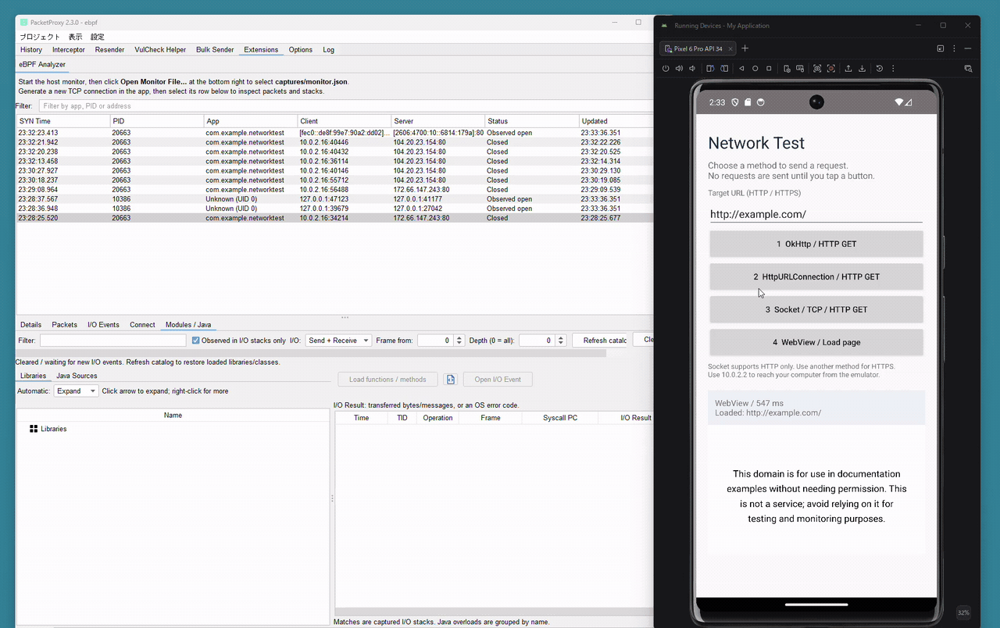

# eBPF Analyzer

An eBPF-powered [PacketProxy](https://github.com/DeNA/PacketProxy) plugin for network analysis, with process attribution and native/Java stack inspection via Frida.

> **Experimental — early development.** This project is actively being developed and is not yet a stable release. Features, UI, and output formats may change without backward compatibility. Testing has focused on a rooted Android x86_64 emulator (API 34); other environments are not yet fully validated. Captured events and stacks may be incomplete. Intended for investigation and testing in controlled environments.

Monitor Android TCP connections, packet copies, and syscall events in a separate **eBPF Analyzer** tab. **No proxy listener, device proxy settings.** Original traffic continues normally; TLS payloads remain encrypted.



*Trace Android requests to Java call sites and inspect the matching send/receive events.*

## Requirements

- PacketProxy on Windows/Linux x86_64 or macOS Intel/Apple Silicon.
- A rooted **Android x86_64** device with the required BPF/kernel support. Tested on Android Emulator API 34.
- Android Platform Tools (`adb`) available on PATH.

## Build with GitHub Actions

1. Open [Actions > Build](https://github.com/DoranekoSystems/ebpf-analyzer/actions/workflows/build.yml).
2. Choose **Run workflow**, or select a successful run triggered by a push or pull request.
3. Download the artifact for your desktop:

   | Desktop | Artifact |
   | --- | --- |
   | Windows x86_64 | `ebpf-analyzer-windows-amd64` |
   | Linux x86_64 | `ebpf-analyzer-linux-amd64` |
   | macOS Intel | `ebpf-analyzer-darwin-amd64` |
   | macOS Apple Silicon | `ebpf-analyzer-darwin-arm64` |

4. Extract the artifact and its enclosed distribution ZIP.

Each package contains the plugin JAR, desktop monitor, one Android x86_64 executable, and Frida scripts. The [workflow](.github/workflows/build.yml) builds these components and runs Go and UI tests. PacketProxy is installed separately.

## Install and run

### 1. Install the plugin

Copy `plugin/CommunicationOrigins.jar` to your home directory's `.packetproxy/extensions/` folder, then restart PacketProxy:

- Windows: `%USERPROFILE%\.packetproxy\extensions\`
- Linux/macOS: `~/.packetproxy/extensions/`

### 2. Install the Android executable

Run these commands from the extracted package directory. Replace `emulator-5554` with your device serial from `adb devices`.

```sh
adb -s emulator-5554 push android-x86_64/ebpf-analyzer /data/local/tmp/ebpf-analyzer
adb -s emulator-5554 shell su 0 chmod 755 /data/local/tmp/ebpf-analyzer
```

### 3. Start monitoring

Windows PowerShell:

```powershell
./monitor.exe -serial emulator-5554 -output captures/monitor.json
```

Linux/macOS:

```sh
chmod +x monitor
./monitor -serial emulator-5554 -output captures/monitor.json
```

The host monitor starts the Android collector automatically. Stop monitoring with **Ctrl+C**.

### 4. Open the analyzer

In PacketProxy, open **Extensions > eBPF Analyzer**, click **Open Monitor File...** at the **bottom right**, and select `captures/monitor.json` created by the monitor in step 3. The selected file path appears above the status bar. Enable the extension under Options if needed.

The Android collector refreshes its UID-to-package mapping when the installed package list changes. Apps installed during capture are resolved without restarting the monitor; temporary read failures keep the last good mapping and retry after five seconds. Shared or unmapped UIDs can still lack a unique package name.

Generate a **new TCP connection** in the target app, then select it to inspect **Packets**, **Connect**, and **I/O Events**. UDP/QUIC is outside TCP ownership tracking. Right-click a table and choose **Clear** to clear its displayed records while collection continues.

For a device other than `emulator-5554`, also set PacketProxy's Java property `-Dpacketproxy.adb.serial=YOUR_SERIAL`.

## Optional: native and Java stacks with Frida

1. Run a matching Android x86_64 `frida-server` as root, and install Python `frida` / `frida-tools` on the desktop.

   ```sh
   python -m pip install frida frida-tools
   python -c "import frida; print(frida.__version__)"
   ```

   Use the same version of `frida-server` as the Python `frida` version printed above. Run these commands with the Python interpreter used by PacketProxy (default: `python`; override with `-Dpacketproxy.frida.python=/path/to/python`). Installing the Python packages does not install or start `frida-server` on Android.

2. Copy `frida/agent.js`, `frida/bridge.py`, and `frida/stream.py` into `~/.packetproxy/extensions/ebpf-frida/` under your home directory.
3. Select a connection and choose **Settings > I/O analysis: Frida**.
4. Wait for **Collecting PID ...**, generate traffic, and select an event to inspect its saved stacks.

Collection covers the selected PID's supported TCP I/O across all threads and connections. Java frames depend on the executing thread; past Java stacks cannot be recovered. Stop with **Stop**, **None**, or **Manual**.

## License

User-space code and documentation: [Apache-2.0](LICENSE). eBPF programs: [GPL-2.0-only](LICENSES/GPL-2.0-only.txt). See [license scope](LICENSES/README.md).
